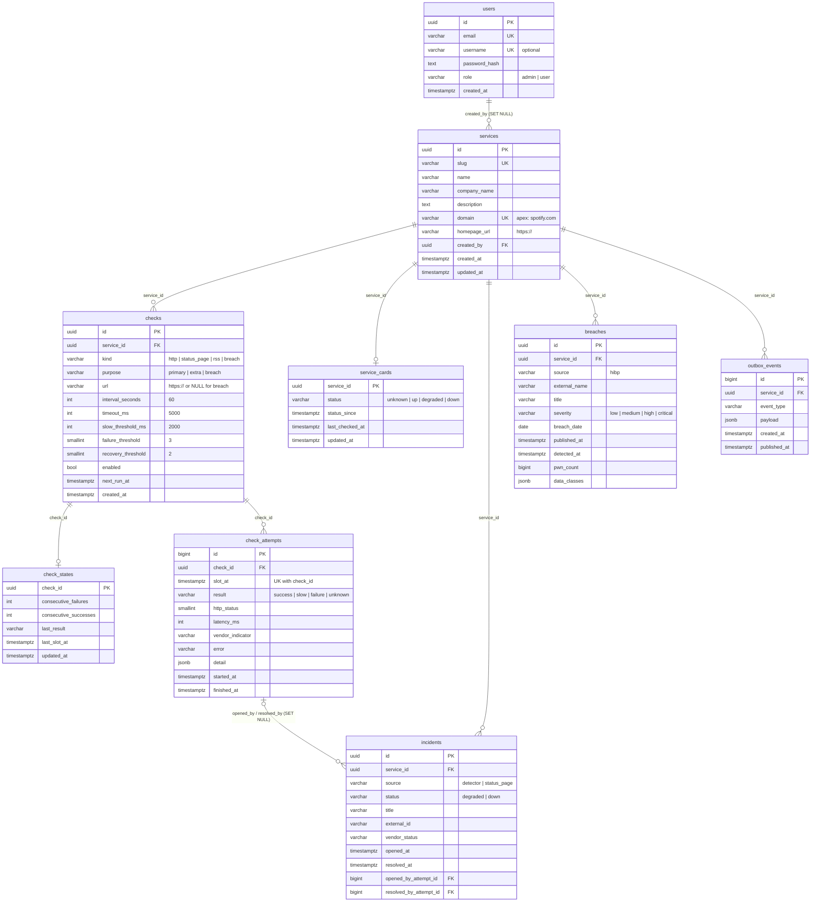
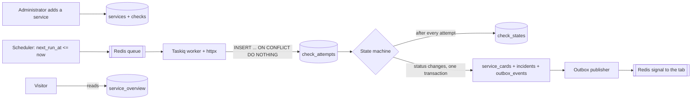

# down-detector database

[Русская версия](db.md)

Reference for the project database: what each table is for, every column, constraint, index, and relationship, the write rules, common queries, and how to work with migrations. This document is checked against the live schema after revision `0003_add_username`.

## Contents

1. [Overview](#overview)
2. [PostgreSQL and Redis](#postgresql-and-redis)
3. [ER diagram](#er-diagram)
4. [Data flow](#data-flow)
5. [Table reference](#table-reference)
6. [The `service_overview` view](#the-service_overview-view)
7. [Value dictionary](#value-dictionary)
8. [How a source response becomes a result](#how-a-source-response-becomes-a-result)
9. [Transactions and redelivery](#transactions-and-redelivery)
10. [Foreign keys and deletion](#foreign-keys-and-deletion)
11. [Common queries](#common-queries)
12. [Conventions](#conventions)
13. [Migrations](#migrations)
14. [Tests](#tests)
15. [What the database does not do](#what-the-database-does-not-do)

## Overview

One PostgreSQL 17 database: ten tables, including Alembic's `alembic_version`, and one view. Alembic owns the schema; nobody creates tables by hand. SQLAlchemy models live in `src/downdetector/db/`, one file per table.

| Table | Purpose | Model |
|---|---|---|
| `users` | accounts and roles | `db/user.py` |
| `services` | catalog of watched services | `db/service.py` |
| `checks` | what to check, how often, with which thresholds | `db/check.py` |
| `check_attempts` | log of check attempts, one per slot | `db/check_attempt.py` |
| `check_states` | current success and failure streaks | `db/check_state.py` |
| `service_cards` | the status a visitor sees | `db/service_card.py` |
| `incidents` | incidents, our own and vendor-published | `db/incident.py` |
| `breaches` | published data breaches | `db/breach.py` |
| `outbox_events` | events for the site waiting to be sent | `db/outbox.py` |
| `service_overview` (view) | one ready row per service for the site | migration only |
| `alembic_version` | applied revision number | managed by Alembic |

**What exists in code today.** Login (`users`) and all tables with their constraints are in place. The scheduler, the check worker, the state machine, and the outbox publisher arrive in later slices. Wherever this document says "the worker writes" or "the state machine decides", it describes how those parts will use the tables that already exist.

## PostgreSQL and Redis

| PostgreSQL — data that must not be lost | Redis — short-lived data |
|---|---|
| accounts, catalog, checks, attempt log, streaks, cards, incidents, breaches, outbox | Taskiq job queue, login sessions `session:{token}` (8-hour TTL), the "card changed" signal for a tab |

Statuses are never written to Redis. If Redis is flushed, users are logged out and the scheduler re-queues jobs. Cards and history stay in PostgreSQL.

## ER diagram



A good reading order: who (`users`) → what we watch (`services`) → how we check (`checks`) → what happened (`check_attempts`, `check_states`) → what the visitor sees (`service_cards`, `incidents`, `breaches`) → what to tell the site (`outbox_events`).

## Data flow



1. An administrator adds a row to `services` and one or more rows to `checks`.
2. The scheduler selects enabled checks with `next_run_at <= now()` and queues jobs in Redis.
3. The worker sends the request through httpx with the `timeout_ms` timeout and writes an attempt to `check_attempts`. Repeating the same slot adds nothing.
4. The state machine updates `check_states`. When a threshold is reached, one transaction changes `service_cards`, opens or closes `incidents`, and inserts an `outbox_events` row.
5. The publisher reads unsent events, sends a Redis signal, and sets `published_at`.
6. A visitor reads only PostgreSQL, mostly `service_overview`. The Redis signal only tells an open tab to re-read the card. A visitor request never calls YouTube, Discord, or HIBP.

## Table reference

In column tables, "NULL" says whether the column may be empty, and "Default" is the database-side default. The application generates UUID identifiers (`uuid4`); the database has no default for them.

### `users`

Accounts of visitors and administrators. Revisions `0001_create_users` and `0003_add_username`.

| Column | Type | NULL | Default | Description |
|---|---|---|---|---|
| `id` | `uuid` | no | application | primary key |
| `email` | `varchar(254)` | no | | login, stored after `strip().casefold()` |
| `username` | `varchar(32)` | yes | | optional public name, stored after `strip().casefold()` |
| `password_hash` | `text` | no | | Argon2id hash (`m=19456,t=2,p=1`); the plain password is never stored |
| `role` | `varchar(16)` | no | | `admin` or `user` |
| `created_at` | `timestamptz` | no | `now()` | creation time, not exposed by the API |

| Constraint / index | Kind | Rule |
|---|---|---|
| `users_pkey` | PK | `id` |
| `uq_users_email` | UNIQUE | `email` |
| `uq_users_username` | UNIQUE | `username`; any number of rows may be `NULL` |
| `ck_users_role` | CHECK | `role IN ('admin', 'user')` |
| `ck_users_username` | CHECK | `username IS NULL OR username ~ '^[a-z0-9_]{3,32}$'` |

Write rules:

- registration always writes `role = 'user'`; a `role` field in the request is dropped;
- the first administrator is created at startup from `ADMIN_EMAIL` and `ADMIN_PASSWORD`; a restart does not change the row, and its `username` is `NULL`;
- login is by email; `username` is not used to log in;
- if the email or the `username` is taken, registration answers with the same 409 `{"detail": "Could not complete registration"}` and does not say which one.

### `services`

Catalog of watched services. Only an administrator adds rows. Revision `0002_monitoring_schema`.

| Column | Type | NULL | Default | Description |
|---|---|---|---|---|
| `id` | `uuid` | no | application | primary key |
| `slug` | `varchar(64)` | no | | short URL name: `spotify`, `discord` |
| `name` | `varchar(100)` | no | | display name |
| `company_name` | `varchar(100)` | yes | | owning company |
| `description` | `text` | yes | | card description |
| `domain` | `varchar(253)` | no | | apex domain: `spotify.com`, not `open.spotify.com` |
| `homepage_url` | `varchar(2048)` | no | | site address, for example `https://open.spotify.com` |
| `created_by` | `uuid` | yes | | administrator who added the service |
| `created_at` | `timestamptz` | no | `now()` | creation time |
| `updated_at` | `timestamptz` | no | `now()` | last change, set by the application |

| Constraint / index | Kind | Rule |
|---|---|---|
| `pk_services` | PK | `id` |
| `uq_services_slug` | UNIQUE | `slug` |
| `uq_services_domain` | UNIQUE | `domain`; services are looked up by this column |
| `ck_services_slug` | CHECK | `slug ~ '^[a-z0-9]+(-[a-z0-9]+)*$'` |
| `ck_services_name` | CHECK | `length(btrim(name)) > 0` |
| `ck_services_domain` | CHECK | lowercase `a-z0-9-` labels separated by dots, at least two labels; no scheme, path, or port |
| `ck_services_homepage_url` | CHECK | `homepage_url LIKE 'https://%'` |
| `fk_services_created_by_users` | FK | `created_by → users.id`, `ON DELETE SET NULL` |

`domain` is the apex domain, for example `spotify.com`. Services and breaches are looked up by it. The subdomain used for requests lives in `homepage_url` and `checks.url`.

### `checks`

What to check for a service, with which module, how often, and with which thresholds. Revision `0002_monitoring_schema`.

| Column | Type | NULL | Default | Description |
|---|---|---|---|---|
| `id` | `uuid` | no | application | primary key |
| `service_id` | `uuid` | no | | service |
| `kind` | `varchar(16)` | no | | check module: `http`, `status_page`, `rss`, `breach` |
| `purpose` | `varchar(16)` | no | | role: `primary`, `extra`, `breach` |
| `url` | `varchar(2048)` | yes | | request address; empty for `breach` |
| `interval_seconds` | `integer` | no | `60` | check period, seconds |
| `timeout_ms` | `integer` | no | `5000` | hard request timeout |
| `slow_threshold_ms` | `integer` | no | `2000` | slower responses count as `slow` |
| `failure_threshold` | `smallint` | no | `3` | `failure` results in a row that mean `down` |
| `recovery_threshold` | `smallint` | no | `2` | `success` results in a row that bring back `up` |
| `enabled` | `boolean` | no | `true` | the scheduler skips disabled checks |
| `next_run_at` | `timestamptz` | no | `now()` | when to run next |
| `created_at` | `timestamptz` | no | `now()` | creation time |

| Constraint / index | Kind | Rule |
|---|---|---|
| `pk_checks` | PK | `id` |
| `fk_checks_service_id_services` | FK | `service_id → services.id`, `ON DELETE CASCADE` |
| `ck_checks_kind` | CHECK | `kind IN ('http', 'status_page', 'rss', 'breach')` |
| `ck_checks_purpose` | CHECK | `purpose IN ('primary', 'extra', 'breach')` |
| `ck_checks_url` | CHECK | `url IS NULL OR url LIKE 'https://%'` |
| `ck_checks_breach_purpose` | CHECK | `(kind = 'breach') = (purpose = 'breach')` |
| `ck_checks_breach_url` | CHECK | `(kind = 'breach') = (url IS NULL)` |
| `ck_checks_interval_seconds` | CHECK | 30 to 86400 |
| `ck_checks_timeout_ms` | CHECK | 100 to 30000 |
| `ck_checks_slow_threshold_ms` | CHECK | `> 0` and `< timeout_ms` |
| `ck_checks_failure_threshold` | CHECK | 1 to 20 |
| `ck_checks_recovery_threshold` | CHECK | 1 to 20 |
| `uq_checks_target` | UNIQUE NULLS NOT DISTINCT | `(service_id, kind, url)`; two `breach` checks per service are also rejected |
| `uq_checks_one_primary` | partial unique index | `(service_id) WHERE purpose = 'primary'` |
| `ix_checks_due` | partial index | `(next_run_at) WHERE enabled` — the scheduler query |

Check roles:

- `primary` — the only check that decides the card status;
- `extra` — an additional address; it can lower the card to `degraded`, never to `down`;
- `breach` — polls the breach catalog by `services.domain`; it does not change availability. Recommended `interval_seconds = 3600`.

Interval and thresholds live in the row, not in code. A new service of a known format is added as rows in `services` and `checks`, with no new deployment.

### `check_attempts`

The attempt log. One row is one attempt of one check in one slot. This is a fact; the card status is not decided here. Revision `0002_monitoring_schema`.

| Column | Type | NULL | Default | Description |
|---|---|---|---|---|
| `id` | `bigint` | no | `GENERATED ALWAYS AS IDENTITY` | primary key, insertion order |
| `check_id` | `uuid` | no | | check |
| `slot_at` | `timestamptz` | no | | planned slot time, for example 12:00:00 |
| `result` | `varchar(8)` | no | | `success`, `slow`, `failure`, `unknown` |
| `http_status` | `smallint` | yes | | response code; empty on a dropped connection |
| `latency_ms` | `integer` | yes | | response time |
| `vendor_indicator` | `varchar(16)` | yes | | status page word: `none`, `minor`, `major`, `critical`, `maintenance` |
| `error` | `varchar(500)` | yes | | error text |
| `detail` | `jsonb` | no | `'{}'` | raw source response |
| `started_at` | `timestamptz` | no | | actual start |
| `finished_at` | `timestamptz` | no | | actual end |

| Constraint / index | Kind | Rule |
|---|---|---|
| `pk_check_attempts` | PK | `id` |
| `fk_check_attempts_check_id_checks` | FK | `check_id → checks.id`, `ON DELETE CASCADE` |
| `uq_check_attempts_slot` | UNIQUE | `(check_id, slot_at)` — one slot, one attempt |
| `ck_check_attempts_result` | CHECK | `result IN ('success', 'slow', 'failure', 'unknown')` |
| `ck_check_attempts_http_status` | CHECK | 100 to 599 |
| `ck_check_attempts_latency_ms` | CHECK | `>= 0` |
| `ck_check_attempts_vendor_indicator` | CHECK | `none`, `minor`, `major`, `critical`, `maintenance` |
| `ck_check_attempts_detail` | CHECK | `jsonb_typeof(detail) = 'object'` |
| `ck_check_attempts_finished_at` | CHECK | `finished_at >= started_at` |

The `uq_check_attempts_slot` unique index also serves the per-check history query ordered by time.

### `check_states`

Current streaks for each check. The state machine uses them to decide whether a threshold is reached. Revision `0002_monitoring_schema`.

| Column | Type | NULL | Default | Description |
|---|---|---|---|---|
| `check_id` | `uuid` | no | | primary key and reference to the check |
| `consecutive_failures` | `integer` | no | `0` | failures in a row |
| `consecutive_successes` | `integer` | no | `0` | successes in a row |
| `last_result` | `varchar(8)` | yes | | result of the last counted attempt |
| `last_slot_at` | `timestamptz` | yes | | slot of the last counted attempt |
| `updated_at` | `timestamptz` | no | `now()` | update time |

| Constraint / index | Kind | Rule |
|---|---|---|
| `pk_check_states` | PK | `check_id` |
| `fk_check_states_check_id_checks` | FK | `check_id → checks.id`, `ON DELETE CASCADE` |
| `ck_check_states_consecutive_failures` | CHECK | `>= 0` |
| `ck_check_states_consecutive_successes` | CHECK | `>= 0` |
| `ck_check_states_last_result` | CHECK | `success`, `slow`, `failure`, `unknown` |
| `ck_check_states_one_streak` | CHECK | `consecutive_failures = 0 OR consecutive_successes = 0` |

Both streaks can never be above zero at once. The row is updated after every attempt, in the same transaction as the state machine's decision.

### `service_cards`

The card a visitor sees. One row per service. Revision `0002_monitoring_schema`.

| Column | Type | NULL | Default | Description |
|---|---|---|---|---|
| `service_id` | `uuid` | no | | primary key and reference to the service |
| `status` | `varchar(10)` | no | `'unknown'` | `unknown`, `up`, `degraded`, `down` |
| `status_since` | `timestamptz` | no | `now()` | when the status took effect |
| `last_checked_at` | `timestamptz` | yes | | time of the last check |
| `updated_at` | `timestamptz` | no | `now()` | row update time |

| Constraint / index | Kind | Rule |
|---|---|---|
| `pk_service_cards` | PK | `service_id` |
| `fk_service_cards_service_id_services` | FK | `service_id → services.id`, `ON DELETE CASCADE` |
| `ck_service_cards_status` | CHECK | `status IN ('unknown', 'up', 'degraded', 'down')` |

- Until a threshold is reached, the card keeps the last confirmed status, so it does not flicker on one blip.
- The row appears after the service's first check. Until then `service_overview` shows `unknown`.
- Breaches are not written here; the badge and counts come from `service_overview`.

### `incidents`

Service incidents: detected by our thresholds or published by the vendor on its status page. Revision `0002_monitoring_schema`.

| Column | Type | NULL | Default | Description |
|---|---|---|---|---|
| `id` | `uuid` | no | application | primary key |
| `service_id` | `uuid` | no | | service |
| `source` | `varchar(16)` | no | | `detector` — our threshold; `status_page` — the vendor |
| `status` | `varchar(10)` | no | | `degraded` or `down` |
| `title` | `varchar(255)` | no | | headline |
| `external_id` | `varchar(128)` | yes | | vendor incident id |
| `vendor_status` | `varchar(32)` | yes | | vendor status: `investigating`, `identified`, `monitoring`, `resolved` |
| `opened_at` | `timestamptz` | no | | opened at |
| `resolved_at` | `timestamptz` | yes | | resolved at; empty while open |
| `opened_by_attempt_id` | `bigint` | yes | | attempt that opened it |
| `resolved_by_attempt_id` | `bigint` | yes | | attempt that resolved it |

| Constraint / index | Kind | Rule |
|---|---|---|
| `pk_incidents` | PK | `id` |
| `fk_incidents_service_id_services` | FK | `service_id → services.id`, `ON DELETE CASCADE` |
| `fk_incidents_opened_by_attempt_id_check_attempts` | FK | `→ check_attempts.id`, `ON DELETE SET NULL` |
| `fk_incidents_resolved_by_attempt_id_check_attempts` | FK | `→ check_attempts.id`, `ON DELETE SET NULL` |
| `ck_incidents_source` | CHECK | `source IN ('detector', 'status_page')` |
| `ck_incidents_status` | CHECK | `status IN ('degraded', 'down')` |
| `ck_incidents_external_id` | CHECK | `(source = 'status_page') = (external_id IS NOT NULL)` |
| `ck_incidents_resolved_after_opened` | CHECK | `resolved_at IS NULL OR resolved_at >= opened_at` |
| `uq_incidents_one_open_detector` | partial unique index | `(service_id) WHERE source = 'detector' AND resolved_at IS NULL` |
| `uq_incidents_external` | partial unique index | `(service_id, external_id) WHERE external_id IS NOT NULL` |
| `ix_incidents_service_opened` | index | `(service_id, opened_at DESC)` — a service's incident feed |

- A service has at most one open `detector` incident.
- A vendor incident with the same `external_id` is not created twice, so re-reading `incidents/unresolved.json` is safe: the insert uses `ON CONFLICT DO NOTHING`.
- A vendor incident's `status` comes from its `impact` field: `none` or `minor` → `degraded`, `major` or `critical` → `down`.

### `breaches`

Published data breaches of a service. They do not affect availability. Revision `0002_monitoring_schema`.

| Column | Type | NULL | Default | Description |
|---|---|---|---|---|
| `id` | `uuid` | no | application | primary key |
| `service_id` | `uuid` | no | | service |
| `source` | `varchar(16)` | no | | source: `hibp` |
| `external_name` | `varchar(128)` | no | | breach name at the source (`Name` in HIBP) |
| `title` | `varchar(255)` | no | | headline |
| `severity` | `varchar(10)` | no | | `low`, `medium`, `high`, `critical` |
| `breach_date` | `date` | yes | | when the breach happened |
| `published_at` | `timestamptz` | no | | when it was published (`AddedDate` in HIBP) |
| `detected_at` | `timestamptz` | no | `now()` | when we detected it |
| `pwn_count` | `bigint` | yes | | number of affected accounts |
| `data_classes` | `jsonb` | no | `'[]'` | kinds of leaked data, array of strings |

| Constraint / index | Kind | Rule |
|---|---|---|
| `pk_breaches` | PK | `id` |
| `fk_breaches_service_id_services` | FK | `service_id → services.id`, `ON DELETE CASCADE` |
| `uq_breaches_external` | UNIQUE | `(service_id, source, external_name)` — the hourly poll creates no duplicates |
| `ck_breaches_source` | CHECK | `source IN ('hibp')` |
| `ck_breaches_severity` | CHECK | `severity IN ('low', 'medium', 'high', 'critical')` |
| `ck_breaches_pwn_count` | CHECK | `pwn_count >= 0` |
| `ck_breaches_data_classes` | CHECK | `jsonb_typeof(data_classes) = 'array'` |
| `ix_breaches_service_published` | index | `(service_id, published_at DESC)` |

A major breach is one with `severity` `high` or `critical`. A new breach source means a new value in `ck_breaches_source`.

### `outbox_events`

Event queue for the site, following the transactional outbox pattern. Revision `0002_monitoring_schema`.

| Column | Type | NULL | Default | Description |
|---|---|---|---|---|
| `id` | `bigint` | no | `GENERATED ALWAYS AS IDENTITY` | primary key and event order |
| `service_id` | `uuid` | no | | service |
| `event_type` | `varchar(64)` | no | | event type, for example `card.status_changed` |
| `payload` | `jsonb` | no | `'{}'` | event data |
| `created_at` | `timestamptz` | no | `now()` | creation time |
| `published_at` | `timestamptz` | yes | | sent at; empty while unsent |

| Constraint / index | Kind | Rule |
|---|---|---|
| `pk_outbox_events` | PK | `id` |
| `fk_outbox_events_service_id_services` | FK | `service_id → services.id`, `ON DELETE CASCADE` |
| `ck_outbox_events_event_type` | CHECK | `event_type ~ '^[a-z_]+(\.[a-z_]+)+$'` |
| `ck_outbox_events_payload` | CHECK | `jsonb_typeof(payload) = 'object'` |
| `ix_outbox_events_unpublished` | partial index | `(id) WHERE published_at IS NULL` — the publisher query |

## The `service_overview` view

One ready-made row per service for the home page and search. Created in revision `0002_monitoring_schema`; it has no SQLAlchemy model.

| Column | Type | Source |
|---|---|---|
| `service_id` | `uuid` | `services.id` |
| `slug`, `name`, `company_name`, `domain` | `varchar` | `services` |
| `status` | `varchar` | `service_cards.status`, or `'unknown'` when there is no card |
| `status_since`, `last_checked_at` | `timestamptz` | `service_cards` |
| `breach_count` | `bigint` | number of `breaches` rows, `0` when none |
| `major_breach_count` | `bigint` | breaches with `severity` `high` or `critical`, `0` when none |
| `latest_breach_published_at` | `timestamptz` | maximum `breaches.published_at` |

Counts are computed on every read, so they never drift from the data. The view can only be changed by a new revision: `DROP VIEW` then `CREATE VIEW`.

## Value dictionary

All enumerations are lowercase English words.

| Column | Values | Meaning |
|---|---|---|
| `users.role` | `admin`, `user` | an administrator manages the catalog; a user only views |
| `checks.kind` | `http`, `status_page`, `rss`, `breach` | which module runs the check |
| `checks.purpose` | `primary`, `extra`, `breach` | how the result affects the card |
| `check_attempts.result`, `check_states.last_result` | `success`, `slow`, `failure`, `unknown` | outcome of one attempt |
| `check_attempts.vendor_indicator` | `none`, `minor`, `major`, `critical`, `maintenance` | the status page word |
| `service_cards.status` | `unknown`, `up`, `degraded`, `down` | what the visitor sees |
| `incidents.source` | `detector`, `status_page` | who detected the incident |
| `incidents.status` | `degraded`, `down` | incident severity |
| `breaches.source` | `hibp` | breach source |
| `breaches.severity` | `low`, `medium`, `high`, `critical` | breach severity |

## How a source response becomes a result

| Source | Response | `result` |
|---|---|---|
| http | 2xx or 3xx faster than `slow_threshold_ms` | `success` |
| http | 2xx or 3xx slower than `slow_threshold_ms` | `slow` |
| http | 5xx, timeout, dropped connection | `failure` |
| http | 429 "too many requests" | `unknown`: our request rate, not an outage; the status does not change |
| status_page | `none` | `success` |
| status_page | `minor` (partial outage) | `slow`: the card goes `degraded` at once |
| status_page | `major` or `critical` | `failure`: one response is enough for `down` |
| status_page | `maintenance` | `unknown` |

`slow` means "working, but worse than usual". For the card it is a `degraded` signal.

Card transitions the state machine will apply:

| Condition | Transition |
|---|---|
| `consecutive_failures` reaches `failure_threshold` on `primary` | → `down` |
| `consecutive_successes` reaches `recovery_threshold` | → `up` |
| `slow` on `primary` or `extra`, `minor` on a status page | → `degraded` at once |
| `major` or `critical` on a status page | → `down` at once |
| `unknown` | status and streaks unchanged |
| threshold not reached | the last confirmed status stays |

## Transactions and redelivery

**One slot, one attempt.** Redis can deliver the same job twice. The worker writes the attempt like this:

```sql
INSERT INTO check_attempts (check_id, slot_at, result, started_at, finished_at)
VALUES (:check_id, :slot_at, :result, :started_at, :finished_at)
ON CONFLICT ON CONSTRAINT uq_check_attempts_slot DO NOTHING
RETURNING id;
```

If `RETURNING` returns no row, the slot is already counted and the streaks are left alone.

**A status change is one transaction.** It contains:

1. `UPDATE check_states` — new streaks;
2. `UPDATE service_cards` — new status and `status_since`;
3. `INSERT` or `UPDATE incidents` — open or close an incident;
4. `INSERT outbox_events` — the `card.status_changed` event.

If the process dies before `COMMIT`, nothing is saved. If it dies after, the event stays with `published_at IS NULL`, and the next publisher pass sends it.

**Deduplicating external data.** Vendor incidents are protected by `uq_incidents_external`, breaches by `uq_breaches_external`. Re-reading a source with `ON CONFLICT DO NOTHING` creates no duplicates.

## Foreign keys and deletion

| Reference | When the parent is deleted |
|---|---|
| `services.created_by → users.id` | `SET NULL`: the service stays without an author |
| `checks.service_id → services.id` | `CASCADE` |
| `check_states.check_id → checks.id` | `CASCADE` |
| `check_attempts.check_id → checks.id` | `CASCADE` |
| `service_cards.service_id → services.id` | `CASCADE` |
| `incidents.service_id → services.id` | `CASCADE` |
| `incidents.opened_by_attempt_id → check_attempts.id` | `SET NULL` |
| `incidents.resolved_by_attempt_id → check_attempts.id` | `SET NULL` |
| `breaches.service_id → services.id` | `CASCADE` |
| `outbox_events.service_id → services.id` | `CASCADE` |

Deleting a service removes all its checks, attempts, streaks, card, incidents, breaches, and events. Deleting a check clears incident references to its attempts; the incidents themselves stay.

## Common queries

Home page cards:

```sql
SELECT slug, name, status, status_since, last_checked_at,
       breach_count, major_breach_count
FROM service_overview
ORDER BY name;
```

Domain search:

```sql
SELECT * FROM service_overview WHERE domain = 'discord.com';
```

Checks that are due:

```sql
SELECT id FROM checks
WHERE enabled AND next_run_at <= now()
ORDER BY next_run_at
FOR UPDATE SKIP LOCKED;
```

Last 20 attempts of a check:

```sql
SELECT slot_at, result, http_status, latency_ms, error
FROM check_attempts
WHERE check_id = :check_id
ORDER BY slot_at DESC
LIMIT 20;
```

Failure share per service over the last day:

```sql
SELECT s.name,
       count(*) FILTER (WHERE a.result = 'failure') AS failures,
       count(*) AS attempts
FROM check_attempts a
JOIN checks c ON c.id = a.check_id
JOIN services s ON s.id = c.service_id
WHERE a.slot_at > now() - interval '24 hours'
GROUP BY s.name;
```

Open incidents:

```sql
SELECT s.name, i.source, i.status, i.title, i.opened_at
FROM incidents i JOIN services s ON s.id = i.service_id
WHERE i.resolved_at IS NULL
ORDER BY i.opened_at DESC;
```

Services with problems:

```sql
SELECT name, status, status_since FROM service_overview
WHERE status IN ('degraded', 'down');
```

Unsent outbox events:

```sql
SELECT id, event_type, payload FROM outbox_events
WHERE published_at IS NULL
ORDER BY id
LIMIT 100
FOR UPDATE SKIP LOCKED;
```

## Conventions

| Topic | Rule |
|---|---|
| Enumerations | `varchar` + `CHECK`. A new value means replacing one `CHECK` in a new revision |
| Constraint names | `pk_<table>`, `fk_<table>_<column>_<parent>`, `uq_<table>_<meaning>`, `ck_<table>_<column>`, `ix_<table>_<meaning>`. The exception is `users_pkey` from the first revision |
| Time | always `timestamptz`; code uses `datetime` with `tzinfo` |
| Identifiers | entities use application UUIDs; the `check_attempts` and `outbox_events` logs use `bigint identity` |
| Text keys | `email`, `username`, `domain`, `slug` are stored normalized, lowercase |
| Raw data | only in the `jsonb` columns `detail`, `payload`, `data_classes` |
| URLs | `https://` only |

## Migrations

| Revision | What it does |
|---|---|
| `0001_create_users` | the `users` table |
| `0002_monitoring_schema` | `services`, `checks`, `check_states`, `check_attempts`, `service_cards`, `incidents`, `breaches`, `outbox_events`, `service_overview` |
| `0003_add_username` | the `users.username` column, `uq_users_username`, `ck_users_username` |

Apply all revisions:

```bash
docker compose up -d --wait postgres
uv run alembic upgrade head
```

Roll back the last revision:

```bash
uv run alembic downgrade -1
```

Roll back to the original `users` table, with no monitoring and no `username`:

```bash
uv run alembic downgrade 0001_create_users
```

Show the current revision:

```bash
uv run alembic current
```

In Compose, the `api` container runs `alembic upgrade head` itself before starting. `alembic/env.py` takes the address only from `DATABASE_URL` and the table list from `downdetector.db.metadata`.

**How to change the schema.**

1. Change or add a model in `src/downdetector/db/`. Import a new table in `db/metadata.py`.
2. Write the new revision in `alembic/versions/` by hand. Its number is the next one; `down_revision` is the current head.
3. Constraint names in the model and the revision must match.
4. Never edit old revisions.
5. Run the tests: `test_live_schema_matches_metadata` fails if the models and the database drift apart.

## Tests

```bash
docker compose up -d --wait postgres redis
uv run pytest -q
docker compose stop postgres redis
```

Tests use a separate `downdetector_test` database and Redis database 1. They never touch the working `downdetector` database. Before every test the tables are cleared with `TRUNCATE ... RESTART IDENTITY CASCADE`.

| File | What it checks |
|---|---|
| `tests/db/test_schema.py` | the set of tables and the view, models match the database, downgrade and upgrade again |
| `tests/db/test_catalog.py` | https only, domain and slug format, one `primary`, `breach` rules, thresholds, defaults, cascades |
| `tests/db/test_attempts.py` | one slot, one attempt; redelivery creates no duplicate; four results; `detail` is an object; one streak |
| `tests/db/test_incidents.py` | one open incident, no duplicate vendor incidents, date order |
| `tests/db/test_breaches.py` | no duplicate breaches, `service_overview` metrics, a breach does not change status |
| `tests/db/test_outbox.py` | card, incident, and event in one transaction, full rollback, event order |
| `tests/db/test_friends_data.py` | the service catalog, checks and attempts, reloading vendor incidents, domain lookup, a `degraded` status, breach counts |
| `tests/auth/test_accounts.py` | `users` structure, email and `username` normalization, registration, first administrator |
| `tests/api/test_auth.py` | login and registration routes, including `username` |

## What the database does not do

- **Public host check.** "Not localhost, not a private network, no redirect there" needs DNS and a check on every request. Application code does it before writing, and the worker does it when requesting. The database only checks `https://`.
- **Status transitions.** Thresholds live in `checks` and streaks in `check_states`, but the state machine in code decides the transition.
- **Login sessions.** They live in Redis, not in the database.
- **`updated_at`.** The application updates it; there are no database triggers.
- **Permissions.** The API checks who may write to the catalog using `users.role`. There are no separate PostgreSQL roles.
