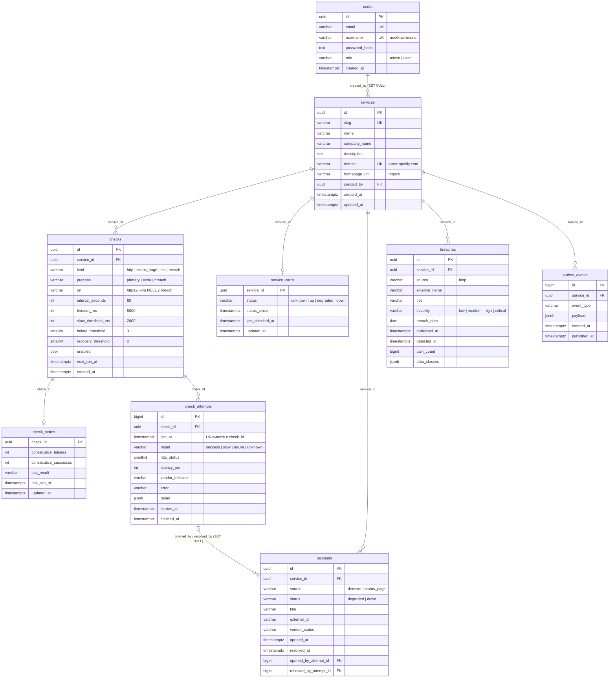
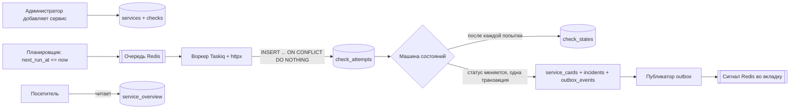

# База данных down-detector

[English version](db.en.md)

Справочник по базе данных проекта: назначение каждой таблицы, все колонки, ограничения, индексы и связи, правила записи, типовые запросы и работа с миграциями. Документ сверен с живой схемой после ревизии `0003_add_username`.

## Содержание

1. [Обзор](#обзор)
2. [PostgreSQL и Redis](#postgresql-и-redis)
3. [ER-диаграмма](#er-диаграмма)
4. [Путь данных](#путь-данных)
5. [Справочник таблиц](#справочник-таблиц)
6. [Представление `service_overview`](#представление-service_overview)
7. [Словарь значений](#словарь-значений)
8. [Как ответ источника становится результатом](#как-ответ-источника-становится-результатом)
9. [Транзакции и повторная доставка](#транзакции-и-повторная-доставка)
10. [Внешние ключи и удаление](#внешние-ключи-и-удаление)
11. [Типовые запросы](#типовые-запросы)
12. [Соглашения](#соглашения)
13. [Миграции](#миграции)
14. [Тесты](#тесты)
15. [Границы базы](#границы-базы)

## Обзор

Одна база PostgreSQL 17: десять таблиц, включая служебную `alembic_version`, и одно представление. Схемой владеет Alembic, таблицы руками не создаются. Модели SQLAlchemy лежат в `src/downdetector/db/`, по одному файлу на таблицу.

| Таблица | Назначение | Модель |
|---|---|---|
| `users` | учётки и роли | `db/user.py` |
| `services` | каталог наблюдаемых сервисов | `db/service.py` |
| `checks` | что проверять, как часто, с какими порогами | `db/check.py` |
| `check_attempts` | журнал попыток проверки, по одной на слот | `db/check_attempt.py` |
| `check_states` | текущие серии успехов и неудач подряд | `db/check_state.py` |
| `service_cards` | статус, который видит посетитель | `db/service_card.py` |
| `incidents` | инциденты: свои и опубликованные вендором | `db/incident.py` |
| `breaches` | опубликованные утечки данных | `db/breach.py` |
| `outbox_events` | события для сайта, ожидающие отправки | `db/outbox.py` |
| `service_overview` (view) | готовая строка сервиса для сайта | только в миграции |
| `alembic_version` | номер применённой ревизии | ведёт Alembic |

**Что уже есть в коде.** Готовы вход (`users`) и все таблицы с ограничениями. Планировщик, воркер проверок, машина состояний и публикатор outbox появятся следующими срезами. Где ниже сказано «воркер пишет» или «машина состояний решает», описано, как эти части будут работать с уже готовыми таблицами.

## PostgreSQL и Redis

| PostgreSQL — данные, которые нельзя потерять | Redis — короткоживущие данные |
|---|---|
| учётки, каталог, проверки, журнал попыток, серии, карточки, инциденты, утечки, outbox | очередь задач Taskiq, сессии входа `session:{token}` (TTL 8 часов), сигнал вкладке «карточка изменилась» |

Статусы в Redis не пишутся. Если очистить Redis, пользователи будут разлогинены, а планировщик заново поставит задачи. Карточки и история останутся в PostgreSQL.

## ER-диаграмма



Таблицы удобно читать в таком порядке: кто (`users`) → что наблюдаем (`services`) → как проверяем (`checks`) → что получилось (`check_attempts`, `check_states`) → что видит посетитель (`service_cards`, `incidents`, `breaches`) → о чём сообщить сайту (`outbox_events`).

## Путь данных



1. Администратор добавляет строку в `services` и одну или несколько строк в `checks`.
2. Планировщик выбирает включённые проверки с `next_run_at <= now()` и ставит задачи в очередь Redis.
3. Воркер выполняет запрос через httpx с таймаутом `timeout_ms` и записывает попытку в `check_attempts`. Повтор того же слота ничего не добавляет.
4. Машина состояний обновляет `check_states`. Если порог достигнут, она в одной транзакции меняет `service_cards`, открывает или закрывает `incidents` и добавляет строку в `outbox_events`.
5. Публикатор читает неотправленные события, посылает сигнал в Redis и отмечает `published_at`.
6. Посетитель читает только PostgreSQL, в основном `service_overview`. Сигнал Redis лишь говорит открытой вкладке перечитать карточку. Запрос посетителя не ходит в YouTube, Discord или HIBP.

## Справочник таблиц

В таблицах колонок: «NULL» — допускает ли колонка пустое значение; «По умолчанию» — значение на стороне базы. UUID-идентификаторы генерирует приложение (`uuid4`), у базы для них значения по умолчанию нет.

### `users`

Учётки посетителей и администраторов. Ревизии `0001_create_users` и `0003_add_username`.

| Колонка | Тип | NULL | По умолчанию | Описание |
|---|---|---|---|---|
| `id` | `uuid` | нет | приложение | первичный ключ |
| `email` | `varchar(254)` | нет | | логин, хранится после `strip().casefold()` |
| `username` | `varchar(32)` | да | | необязательное публичное имя, хранится после `strip().casefold()` |
| `password_hash` | `text` | нет | | хеш Argon2id (`m=19456,t=2,p=1`), открытого пароля нет |
| `role` | `varchar(16)` | нет | | `admin` или `user` |
| `created_at` | `timestamptz` | нет | `now()` | время создания, наружу через API не отдаётся |

| Ограничение / индекс | Вид | Правило |
|---|---|---|
| `users_pkey` | PK | `id` |
| `uq_users_email` | UNIQUE | `email` |
| `uq_users_username` | UNIQUE | `username`; строк с `NULL` может быть сколько угодно |
| `ck_users_role` | CHECK | `role IN ('admin', 'user')` |
| `ck_users_username` | CHECK | `username IS NULL OR username ~ '^[a-z0-9_]{3,32}$'` |

Правила записи:

- регистрация всегда пишет `role = 'user'`, поле `role` из запроса отбрасывается;
- первого администратора создаёт старт приложения из `ADMIN_EMAIL` и `ADMIN_PASSWORD`; повторный старт строку не меняет, `username` у него `NULL`;
- вход идёт по email; `username` для входа не используется;
- если занят email или `username`, регистрация отвечает одинаковым 409 `{"detail": "Could not complete registration"}` и не говорит, что именно занято.

### `services`

Каталог наблюдаемых сервисов. Строки добавляет только администратор. Ревизия `0002_monitoring_schema`.

| Колонка | Тип | NULL | По умолчанию | Описание |
|---|---|---|---|---|
| `id` | `uuid` | нет | приложение | первичный ключ |
| `slug` | `varchar(64)` | нет | | короткое имя для URL: `spotify`, `discord` |
| `name` | `varchar(100)` | нет | | отображаемое имя |
| `company_name` | `varchar(100)` | да | | компания-владелец |
| `description` | `text` | да | | описание для карточки |
| `domain` | `varchar(253)` | нет | | основной (apex) домен: `spotify.com`, не `open.spotify.com` |
| `homepage_url` | `varchar(2048)` | нет | | адрес сайта, например `https://open.spotify.com` |
| `created_by` | `uuid` | да | | администратор, добавивший сервис |
| `created_at` | `timestamptz` | нет | `now()` | время создания |
| `updated_at` | `timestamptz` | нет | `now()` | время последнего изменения, обновляет приложение |

| Ограничение / индекс | Вид | Правило |
|---|---|---|
| `pk_services` | PK | `id` |
| `uq_services_slug` | UNIQUE | `slug` |
| `uq_services_domain` | UNIQUE | `domain`; по этой колонке ищут сервис |
| `ck_services_slug` | CHECK | `slug ~ '^[a-z0-9]+(-[a-z0-9]+)*$'` |
| `ck_services_name` | CHECK | `length(btrim(name)) > 0` |
| `ck_services_domain` | CHECK | нижний регистр, метки из `a-z0-9-` через точку, минимум две метки; без схемы, пути и порта |
| `ck_services_homepage_url` | CHECK | `homepage_url LIKE 'https://%'` |
| `fk_services_created_by_users` | FK | `created_by → users.id`, `ON DELETE SET NULL` |

`domain` — основной (apex) домен, например `spotify.com`. По нему ищут сервис и утечки. Поддомен для запроса живёт в `homepage_url` и в `checks.url`.

### `checks`

Что проверять у сервиса, каким модулем, как часто и с какими порогами. Ревизия `0002_monitoring_schema`.

| Колонка | Тип | NULL | По умолчанию | Описание |
|---|---|---|---|---|
| `id` | `uuid` | нет | приложение | первичный ключ |
| `service_id` | `uuid` | нет | | сервис |
| `kind` | `varchar(16)` | нет | | модуль проверки: `http`, `status_page`, `rss`, `breach` |
| `purpose` | `varchar(16)` | нет | | роль: `primary`, `extra`, `breach` |
| `url` | `varchar(2048)` | да | | адрес запроса; у `breach` пусто |
| `interval_seconds` | `integer` | нет | `60` | период проверки, секунды |
| `timeout_ms` | `integer` | нет | `5000` | жёсткий таймаут запроса |
| `slow_threshold_ms` | `integer` | нет | `2000` | ответ дольше этого — `slow` |
| `failure_threshold` | `smallint` | нет | `3` | сколько `failure` подряд дают `down` |
| `recovery_threshold` | `smallint` | нет | `2` | сколько `success` подряд возвращают `up` |
| `enabled` | `boolean` | нет | `true` | выключенную проверку планировщик пропускает |
| `next_run_at` | `timestamptz` | нет | `now()` | когда проверку запускать в следующий раз |
| `created_at` | `timestamptz` | нет | `now()` | время создания |

| Ограничение / индекс | Вид | Правило |
|---|---|---|
| `pk_checks` | PK | `id` |
| `fk_checks_service_id_services` | FK | `service_id → services.id`, `ON DELETE CASCADE` |
| `ck_checks_kind` | CHECK | `kind IN ('http', 'status_page', 'rss', 'breach')` |
| `ck_checks_purpose` | CHECK | `purpose IN ('primary', 'extra', 'breach')` |
| `ck_checks_url` | CHECK | `url IS NULL OR url LIKE 'https://%'` |
| `ck_checks_breach_purpose` | CHECK | `(kind = 'breach') = (purpose = 'breach')` |
| `ck_checks_breach_url` | CHECK | `(kind = 'breach') = (url IS NULL)` |
| `ck_checks_interval_seconds` | CHECK | от 30 до 86400 |
| `ck_checks_timeout_ms` | CHECK | от 100 до 30000 |
| `ck_checks_slow_threshold_ms` | CHECK | `> 0` и `< timeout_ms` |
| `ck_checks_failure_threshold` | CHECK | от 1 до 20 |
| `ck_checks_recovery_threshold` | CHECK | от 1 до 20 |
| `uq_checks_target` | UNIQUE NULLS NOT DISTINCT | `(service_id, kind, url)`; две `breach` у сервиса тоже запрещены |
| `uq_checks_one_primary` | уникальный частичный индекс | `(service_id) WHERE purpose = 'primary'` |
| `ix_checks_due` | частичный индекс | `(next_run_at) WHERE enabled` — выборка планировщика |

Роли проверок:

- `primary` — единственная проверка, которая решает статус карточки;
- `extra` — дополнительный адрес; может опустить карточку до `degraded`, но не до `down`;
- `breach` — опрос каталога утечек по `services.domain`; доступность не меняет. Для неё рекомендуется `interval_seconds = 3600`.

Интервал и пороги хранятся в строке, а не в коде. Новый сервис знакомого формата добавляется строками в `services` и `checks` без новой выкладки.

### `check_attempts`

Журнал попыток. Одна строка — одна попытка одной проверки в одном слоте. Это факт; статус карточки здесь не решается. Ревизия `0002_monitoring_schema`.

| Колонка | Тип | NULL | По умолчанию | Описание |
|---|---|---|---|---|
| `id` | `bigint` | нет | `GENERATED ALWAYS AS IDENTITY` | первичный ключ, порядок вставки |
| `check_id` | `uuid` | нет | | проверка |
| `slot_at` | `timestamptz` | нет | | плановое время слота, например 12:00:00 |
| `result` | `varchar(8)` | нет | | `success`, `slow`, `failure`, `unknown` |
| `http_status` | `smallint` | да | | код ответа; пусто при обрыве соединения |
| `latency_ms` | `integer` | да | | время ответа |
| `vendor_indicator` | `varchar(16)` | да | | слово status page: `none`, `minor`, `major`, `critical`, `maintenance` |
| `error` | `varchar(500)` | да | | текст ошибки |
| `detail` | `jsonb` | нет | `'{}'` | сырой ответ источника |
| `started_at` | `timestamptz` | нет | | фактическое начало |
| `finished_at` | `timestamptz` | нет | | фактическое окончание |

| Ограничение / индекс | Вид | Правило |
|---|---|---|
| `pk_check_attempts` | PK | `id` |
| `fk_check_attempts_check_id_checks` | FK | `check_id → checks.id`, `ON DELETE CASCADE` |
| `uq_check_attempts_slot` | UNIQUE | `(check_id, slot_at)` — один слот, одна попытка |
| `ck_check_attempts_result` | CHECK | `result IN ('success', 'slow', 'failure', 'unknown')` |
| `ck_check_attempts_http_status` | CHECK | от 100 до 599 |
| `ck_check_attempts_latency_ms` | CHECK | `>= 0` |
| `ck_check_attempts_vendor_indicator` | CHECK | `none`, `minor`, `major`, `critical`, `maintenance` |
| `ck_check_attempts_detail` | CHECK | `jsonb_typeof(detail) = 'object'` |
| `ck_check_attempts_finished_at` | CHECK | `finished_at >= started_at` |

Уникальный индекс `uq_check_attempts_slot` также служит для выборки истории проверки по времени.

### `check_states`

Текущие серии подряд для каждой проверки. По ним машина состояний решает, достигнут ли порог. Ревизия `0002_monitoring_schema`.

| Колонка | Тип | NULL | По умолчанию | Описание |
|---|---|---|---|---|
| `check_id` | `uuid` | нет | | первичный ключ и ссылка на проверку |
| `consecutive_failures` | `integer` | нет | `0` | неудач подряд |
| `consecutive_successes` | `integer` | нет | `0` | успехов подряд |
| `last_result` | `varchar(8)` | да | | результат последней учтённой попытки |
| `last_slot_at` | `timestamptz` | да | | слот последней учтённой попытки |
| `updated_at` | `timestamptz` | нет | `now()` | время обновления |

| Ограничение / индекс | Вид | Правило |
|---|---|---|
| `pk_check_states` | PK | `check_id` |
| `fk_check_states_check_id_checks` | FK | `check_id → checks.id`, `ON DELETE CASCADE` |
| `ck_check_states_consecutive_failures` | CHECK | `>= 0` |
| `ck_check_states_consecutive_successes` | CHECK | `>= 0` |
| `ck_check_states_last_result` | CHECK | `success`, `slow`, `failure`, `unknown` |
| `ck_check_states_one_streak` | CHECK | `consecutive_failures = 0 OR consecutive_successes = 0` |

Обе серии не могут быть больше нуля одновременно. Строка обновляется после каждой попытки в той же транзакции, что и решение машины состояний.

### `service_cards`

Карточка, которую видит посетитель. Одна строка на сервис. Ревизия `0002_monitoring_schema`.

| Колонка | Тип | NULL | По умолчанию | Описание |
|---|---|---|---|---|
| `service_id` | `uuid` | нет | | первичный ключ и ссылка на сервис |
| `status` | `varchar(10)` | нет | `'unknown'` | `unknown`, `up`, `degraded`, `down` |
| `status_since` | `timestamptz` | нет | `now()` | с какого момента действует статус |
| `last_checked_at` | `timestamptz` | да | | время последней проверки |
| `updated_at` | `timestamptz` | нет | `now()` | время обновления строки |

| Ограничение / индекс | Вид | Правило |
|---|---|---|
| `pk_service_cards` | PK | `service_id` |
| `fk_service_cards_service_id_services` | FK | `service_id → services.id`, `ON DELETE CASCADE` |
| `ck_service_cards_status` | CHECK | `status IN ('unknown', 'up', 'degraded', 'down')` |

- Пока порог не достигнут, на карточке остаётся последний подтверждённый статус, поэтому она не мигает от одного сбоя.
- Строка появляется после первой проверки сервиса. До этого `service_overview` показывает `unknown`.
- Утечки сюда не пишутся: бейдж и счётчики берутся из `service_overview`.

### `incidents`

Инциденты сервиса: обнаруженные нами по порогу и опубликованные вендором на status page. Ревизия `0002_monitoring_schema`.

| Колонка | Тип | NULL | По умолчанию | Описание |
|---|---|---|---|---|
| `id` | `uuid` | нет | приложение | первичный ключ |
| `service_id` | `uuid` | нет | | сервис |
| `source` | `varchar(16)` | нет | | `detector` — наш порог; `status_page` — вендор |
| `status` | `varchar(10)` | нет | | `degraded` или `down` |
| `title` | `varchar(255)` | нет | | заголовок |
| `external_id` | `varchar(128)` | да | | id инцидента у вендора |
| `vendor_status` | `varchar(32)` | да | | статус у вендора: `investigating`, `identified`, `monitoring`, `resolved` |
| `opened_at` | `timestamptz` | нет | | когда открыт |
| `resolved_at` | `timestamptz` | да | | когда закрыт; пусто у открытого |
| `opened_by_attempt_id` | `bigint` | да | | попытка, открывшая инцидент |
| `resolved_by_attempt_id` | `bigint` | да | | попытка, закрывшая инцидент |

| Ограничение / индекс | Вид | Правило |
|---|---|---|
| `pk_incidents` | PK | `id` |
| `fk_incidents_service_id_services` | FK | `service_id → services.id`, `ON DELETE CASCADE` |
| `fk_incidents_opened_by_attempt_id_check_attempts` | FK | `→ check_attempts.id`, `ON DELETE SET NULL` |
| `fk_incidents_resolved_by_attempt_id_check_attempts` | FK | `→ check_attempts.id`, `ON DELETE SET NULL` |
| `ck_incidents_source` | CHECK | `source IN ('detector', 'status_page')` |
| `ck_incidents_status` | CHECK | `status IN ('degraded', 'down')` |
| `ck_incidents_external_id` | CHECK | `(source = 'status_page') = (external_id IS NOT NULL)` |
| `ck_incidents_resolved_after_opened` | CHECK | `resolved_at IS NULL OR resolved_at >= opened_at` |
| `uq_incidents_one_open_detector` | уникальный частичный индекс | `(service_id) WHERE source = 'detector' AND resolved_at IS NULL` |
| `uq_incidents_external` | уникальный частичный индекс | `(service_id, external_id) WHERE external_id IS NOT NULL` |
| `ix_incidents_service_opened` | индекс | `(service_id, opened_at DESC)` — лента инцидентов сервиса |

- У сервиса не больше одного открытого `detector`-инцидента.
- Инцидент вендора с тем же `external_id` не создаётся повторно, поэтому перечитывать `incidents/unresolved.json` безопасно: вставка идёт через `ON CONFLICT DO NOTHING`.
- `status` инцидента вендора берётся из его поля `impact`: `none` или `minor` → `degraded`, `major` или `critical` → `down`.

### `breaches`

Опубликованные утечки данных сервиса. На доступность не влияют. Ревизия `0002_monitoring_schema`.

| Колонка | Тип | NULL | По умолчанию | Описание |
|---|---|---|---|---|
| `id` | `uuid` | нет | приложение | первичный ключ |
| `service_id` | `uuid` | нет | | сервис |
| `source` | `varchar(16)` | нет | | источник: `hibp` |
| `external_name` | `varchar(128)` | нет | | имя утечки у источника (`Name` в HIBP) |
| `title` | `varchar(255)` | нет | | заголовок |
| `severity` | `varchar(10)` | нет | | `low`, `medium`, `high`, `critical` |
| `breach_date` | `date` | да | | когда утечка произошла |
| `published_at` | `timestamptz` | нет | | когда опубликована (`AddedDate` в HIBP) |
| `detected_at` | `timestamptz` | нет | `now()` | когда мы её обнаружили |
| `pwn_count` | `bigint` | да | | число затронутых аккаунтов |
| `data_classes` | `jsonb` | нет | `'[]'` | какие данные утекли, массив строк |

| Ограничение / индекс | Вид | Правило |
|---|---|---|
| `pk_breaches` | PK | `id` |
| `fk_breaches_service_id_services` | FK | `service_id → services.id`, `ON DELETE CASCADE` |
| `uq_breaches_external` | UNIQUE | `(service_id, source, external_name)` — ежечасный опрос не создаёт дублей |
| `ck_breaches_source` | CHECK | `source IN ('hibp')` |
| `ck_breaches_severity` | CHECK | `severity IN ('low', 'medium', 'high', 'critical')` |
| `ck_breaches_pwn_count` | CHECK | `pwn_count >= 0` |
| `ck_breaches_data_classes` | CHECK | `jsonb_typeof(data_classes) = 'array'` |
| `ix_breaches_service_published` | индекс | `(service_id, published_at DESC)` |

Крупной утечкой (major breach) считается утечка с `severity` `high` или `critical`. Новый источник утечек добавляется новым значением в `ck_breaches_source`.

### `outbox_events`

Очередь событий для сайта по паттерну transactional outbox. Ревизия `0002_monitoring_schema`.

| Колонка | Тип | NULL | По умолчанию | Описание |
|---|---|---|---|---|
| `id` | `bigint` | нет | `GENERATED ALWAYS AS IDENTITY` | первичный ключ и порядок событий |
| `service_id` | `uuid` | нет | | сервис |
| `event_type` | `varchar(64)` | нет | | тип события, например `card.status_changed` |
| `payload` | `jsonb` | нет | `'{}'` | данные события |
| `created_at` | `timestamptz` | нет | `now()` | время создания |
| `published_at` | `timestamptz` | да | | время отправки; пусто у неотправленного |

| Ограничение / индекс | Вид | Правило |
|---|---|---|
| `pk_outbox_events` | PK | `id` |
| `fk_outbox_events_service_id_services` | FK | `service_id → services.id`, `ON DELETE CASCADE` |
| `ck_outbox_events_event_type` | CHECK | `event_type ~ '^[a-z_]+(\.[a-z_]+)+$'` |
| `ck_outbox_events_payload` | CHECK | `jsonb_typeof(payload) = 'object'` |
| `ix_outbox_events_unpublished` | частичный индекс | `(id) WHERE published_at IS NULL` — выборка публикатора |

## Представление `service_overview`

Одна готовая строка на каждый сервис для главной страницы и поиска. Создаётся в ревизии `0002_monitoring_schema`, модели SQLAlchemy у него нет.

| Колонка | Тип | Откуда |
|---|---|---|
| `service_id` | `uuid` | `services.id` |
| `slug`, `name`, `company_name`, `domain` | `varchar` | `services` |
| `status` | `varchar` | `service_cards.status`, а если карточки нет — `'unknown'` |
| `status_since`, `last_checked_at` | `timestamptz` | `service_cards` |
| `breach_count` | `bigint` | число строк в `breaches`, без утечек — `0` |
| `major_breach_count` | `bigint` | число утечек с `severity` `high` или `critical`, без утечек — `0` |
| `latest_breach_published_at` | `timestamptz` | максимум `breaches.published_at` |

Счётчики считаются при каждом чтении, поэтому не расходятся с данными. Изменить представление можно только новой ревизией: `DROP VIEW` и `CREATE VIEW`.

## Словарь значений

Все перечисления — английские слова в нижнем регистре.

| Колонка | Значения | Смысл |
|---|---|---|
| `users.role` | `admin`, `user` | администратор управляет каталогом; пользователь только смотрит |
| `checks.kind` | `http`, `status_page`, `rss`, `breach` | какой модуль выполняет проверку |
| `checks.purpose` | `primary`, `extra`, `breach` | как результат влияет на карточку |
| `check_attempts.result`, `check_states.last_result` | `success`, `slow`, `failure`, `unknown` | итог одной попытки |
| `check_attempts.vendor_indicator` | `none`, `minor`, `major`, `critical`, `maintenance` | слово вендора со status page |
| `service_cards.status` | `unknown`, `up`, `degraded`, `down` | что видит посетитель |
| `incidents.source` | `detector`, `status_page` | кто обнаружил инцидент |
| `incidents.status` | `degraded`, `down` | тяжесть инцидента |
| `breaches.source` | `hibp` | источник утечек |
| `breaches.severity` | `low`, `medium`, `high`, `critical` | тяжесть утечки |

## Как ответ источника становится результатом

| Источник | Ответ | `result` |
|---|---|---|
| http | 2xx или 3xx быстрее `slow_threshold_ms` | `success` |
| http | 2xx или 3xx медленнее `slow_threshold_ms` | `slow` |
| http | 5xx, таймаут, обрыв соединения | `failure` |
| http | 429 «слишком часто» | `unknown`: это наш темп запросов, а не авария; статус не меняется |
| status_page | `none` | `success` |
| status_page | `minor` (частичный сбой) | `slow`: карточка сразу становится `degraded` |
| status_page | `major` или `critical` | `failure`: одного ответа достаточно для `down` |
| status_page | `maintenance` | `unknown` |

`slow` значит «работает, но хуже обычного». Для карточки это сигнал `degraded`.

Переходы карточки, которые будет применять машина состояний:

| Условие | Переход |
|---|---|
| `consecutive_failures` достигла `failure_threshold` у `primary` | → `down` |
| `consecutive_successes` достигла `recovery_threshold` | → `up` |
| `slow` у `primary` или у `extra`, `minor` у status page | → `degraded` сразу |
| `major` или `critical` у status page | → `down` сразу |
| `unknown` | статус и серии не меняются |
| порог не достигнут | остаётся последний подтверждённый статус |

## Транзакции и повторная доставка

**Один слот — одна попытка.** Redis может доставить одну задачу дважды. Воркер пишет попытку так:

```sql
INSERT INTO check_attempts (check_id, slot_at, result, started_at, finished_at)
VALUES (:check_id, :slot_at, :result, :started_at, :finished_at)
ON CONFLICT ON CONSTRAINT uq_check_attempts_slot DO NOTHING
RETURNING id;
```

Если `RETURNING` не вернул строку, слот уже учтён, и серии не трогаются.

**Смена статуса — одна транзакция.** В ней же:

1. `UPDATE check_states` — новые серии;
2. `UPDATE service_cards` — новый статус и `status_since`;
3. `INSERT` или `UPDATE incidents` — открыть или закрыть инцидент;
4. `INSERT outbox_events` — событие `card.status_changed`.

Если процесс упадёт до `COMMIT`, не сохранится ничего. Если после — событие останется с `published_at IS NULL`, и следующий проход публикатора его отправит.

**Дедупликация внешних данных.** Инциденты вендора защищены индексом `uq_incidents_external`, утечки — ограничением `uq_breaches_external`. Повторное чтение источника через `ON CONFLICT DO NOTHING` дублей не создаёт.

## Внешние ключи и удаление

| Ссылка | При удалении родителя |
|---|---|
| `services.created_by → users.id` | `SET NULL`: сервис остаётся без автора |
| `checks.service_id → services.id` | `CASCADE` |
| `check_states.check_id → checks.id` | `CASCADE` |
| `check_attempts.check_id → checks.id` | `CASCADE` |
| `service_cards.service_id → services.id` | `CASCADE` |
| `incidents.service_id → services.id` | `CASCADE` |
| `incidents.opened_by_attempt_id → check_attempts.id` | `SET NULL` |
| `incidents.resolved_by_attempt_id → check_attempts.id` | `SET NULL` |
| `breaches.service_id → services.id` | `CASCADE` |
| `outbox_events.service_id → services.id` | `CASCADE` |

Удаление сервиса убирает все его проверки, попытки, серии, карточку, инциденты, утечки и события. Удаление проверки обнуляет ссылки инцидентов на её попытки, а сами инциденты остаются.

## Типовые запросы

Карточки главной страницы:

```sql
SELECT slug, name, status, status_since, last_checked_at,
       breach_count, major_breach_count
FROM service_overview
ORDER BY name;
```

Поиск по домену:

```sql
SELECT * FROM service_overview WHERE domain = 'discord.com';
```

Проверки, которые пора запускать:

```sql
SELECT id FROM checks
WHERE enabled AND next_run_at <= now()
ORDER BY next_run_at
FOR UPDATE SKIP LOCKED;
```

Последние 20 попыток проверки:

```sql
SELECT slot_at, result, http_status, latency_ms, error
FROM check_attempts
WHERE check_id = :check_id
ORDER BY slot_at DESC
LIMIT 20;
```

Доля неудач сервиса за сутки:

```sql
SELECT s.name,
       count(*) FILTER (WHERE a.result = 'failure') AS failures,
       count(*) AS attempts
FROM check_attempts a
JOIN checks c ON c.id = a.check_id
JOIN services s ON s.id = c.service_id
WHERE a.slot_at > now() - interval '24 hours'
GROUP BY s.name;
```

Открытые инциденты:

```sql
SELECT s.name, i.source, i.status, i.title, i.opened_at
FROM incidents i JOIN services s ON s.id = i.service_id
WHERE i.resolved_at IS NULL
ORDER BY i.opened_at DESC;
```

Сервисы с проблемами:

```sql
SELECT name, status, status_since FROM service_overview
WHERE status IN ('degraded', 'down');
```

Неотправленные события outbox:

```sql
SELECT id, event_type, payload FROM outbox_events
WHERE published_at IS NULL
ORDER BY id
LIMIT 100
FOR UPDATE SKIP LOCKED;
```

## Соглашения

| Что | Правило |
|---|---|
| Перечисления | `varchar` + `CHECK`. Новое значение — замена одного `CHECK` в новой ревизии |
| Имена ограничений | `pk_<таблица>`, `fk_<таблица>_<колонка>_<родитель>`, `uq_<таблица>_<смысл>`, `ck_<таблица>_<колонка>`, `ix_<таблица>_<смысл>`. Исключение — `users_pkey` из первой ревизии |
| Время | всегда `timestamptz`; в коде `datetime` с `tzinfo` |
| Идентификаторы | сущности — UUID от приложения; журналы `check_attempts` и `outbox_events` — `bigint identity` |
| Текстовые ключи | `email`, `username`, `domain`, `slug` хранятся нормализованными в нижнем регистре |
| Сырые данные | только в `jsonb`-колонках `detail`, `payload`, `data_classes` |
| URL | только `https://` |

## Миграции

| Ревизия | Что делает |
|---|---|
| `0001_create_users` | таблица `users` |
| `0002_monitoring_schema` | `services`, `checks`, `check_states`, `check_attempts`, `service_cards`, `incidents`, `breaches`, `outbox_events`, `service_overview` |
| `0003_add_username` | колонка `users.username`, `uq_users_username`, `ck_users_username` |

Применить все ревизии:

```bash
docker compose up -d --wait postgres
uv run alembic upgrade head
```

Откатить последнюю ревизию:

```bash
uv run alembic downgrade -1
```

Откатиться к исходной таблице `users` без мониторинга и без `username`:

```bash
uv run alembic downgrade 0001_create_users
```

Узнать текущую ревизию:

```bash
uv run alembic current
```

В Compose контейнер `api` сам выполняет `alembic upgrade head` перед стартом. `alembic/env.py` берёт адрес только из `DATABASE_URL`, а список таблиц — из `downdetector.db.metadata`.

**Как изменить схему.**

1. Изменить или добавить модель в `src/downdetector/db/`. Новую таблицу импортировать в `db/metadata.py`.
2. Написать новую ревизию в `alembic/versions/` вручную. Номер — следующий по порядку, `down_revision` — текущая голова.
3. Имена ограничений в модели и ревизии должны совпадать.
4. Старые ревизии не редактировать.
5. Запустить тесты: `test_live_schema_matches_metadata` упадёт, если модели и база разошлись.

## Тесты

```bash
docker compose up -d --wait postgres redis
uv run pytest -q
docker compose stop postgres redis
```

Тесты используют отдельную базу `downdetector_test` и Redis с индексом 1. Рабочую базу `downdetector` они не трогают. Перед каждым тестом таблицы очищаются через `TRUNCATE ... RESTART IDENTITY CASCADE`.

| Файл | Что проверяет |
|---|---|
| `tests/db/test_schema.py` | набор таблиц и представление, совпадение моделей с базой, откат и повторный накат |
| `tests/db/test_catalog.py` | только https, формат домена и slug, одна `primary`, правила `breach`, пороги, значения по умолчанию, каскады |
| `tests/db/test_attempts.py` | один слот — одна попытка, повтор не создаёт дубль, четыре результата, `detail` — объект, одна серия |
| `tests/db/test_incidents.py` | один открытый инцидент, без дублей инцидентов вендора, порядок дат |
| `tests/db/test_breaches.py` | без дублей утечек, метрики `service_overview`, утечка не меняет статус |
| `tests/db/test_outbox.py` | карточка, инцидент и событие в одной транзакции, откат целиком, порядок событий |
| `tests/db/test_friends_data.py` | каталог сервисов, проверки и попытки, повторная загрузка инцидентов вендора, поиск по домену, статус `degraded`, счётчики утечек |
| `tests/auth/test_accounts.py` | структура `users`, нормализация email и `username`, регистрация, первый администратор |
| `tests/api/test_auth.py` | маршруты входа и регистрации, включая `username` |

## Границы базы

Что проверяет код, а не схема:

- **Публичность хоста.** «Не localhost, не частная сеть, без редиректа туда» требует DNS и проверки при каждом запросе. Это делает код приложения до записи и воркер при запросе. База проверяет только `https://`.
- **Переходы статуса.** Пороги лежат в `checks`, серии — в `check_states`, но решение о переходе принимает машина состояний в коде.
- **Сессии входа.** Живут в Redis, в базе их нет.
- **`updated_at`.** Обновляется приложением, триггеров в базе нет.
- **Права.** Кто может писать в каталог, проверяет API по роли из `users.role`. Отдельных ролей PostgreSQL нет.
